# RepoSeer — End-to-End Pipeline

> **Architecture specification (proposed, not implemented).** The diagrams define the system design, not verified model performance or data availability.

**Goal:** Predict the risk of **confirmed maintenance abandonment of a PyPI package within 12 months after `cutoff_at`**, using only information available at that cutoff. This is an operationally verified target, not a detector of every silent abandonment.

**Prediction modes:**
- **CORE:** D01 → D02 → D09 → D11 (Model A).
- **ENHANCED:** CORE + D03–D08 (Model B, only after validation and deployment gates).
- **External insights:** Optional evidence and narrative; never change a model probability.
- **Dependency impact (D12):** Optional, independent of abandonment risk.

**Global rules:**
- Prediction unit: canonical PyPI `package_id`; versioned package↔GitHub `repo_id` mapping; `repo_group_id` groups packages sharing a repository.
- Historical inputs require **`available_at <= cutoff_at`** and a valid source/mapping revision. `event_at` alone is insufficient.
- Official `already_abandoned` / `scheduled_cessation` statuses override predictions. No score is returned for either.
- Labels: `1` = independently verified cessation effective within the next 12 months; `0` = sufficiently observed and verified continued maintenance; otherwise `unknown/censored`.
- Unknown, missing, partial, and unavailable data are **not zero**. Unsupported or out-of-distribution (OOD) inputs may produce `insufficient_evidence`.
- Agent outputs are evidence-backed signals, **not labels or probabilities**. D09 independently verifies official cessation events.
- Calibrated probabilities apply to the evaluated population, not automatically to all PyPI packages.
- **E0 = CORE; E1 = CORE + deterministic external features; E2 = E1 + specialist-agent features.** E1 retrieval/relevance may use an LLM.

## D00 — System Overview

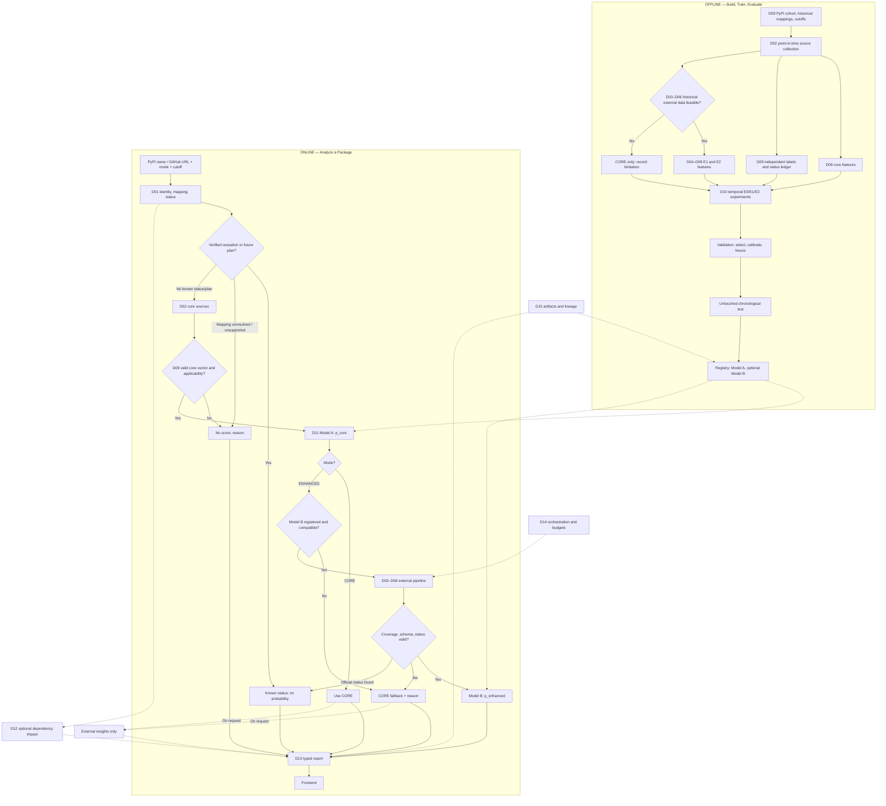

**Time semantics:** `current_inference` uses the deployed model now; `retrospective_analysis` applies a current model to past features; only D10 produces a valid `prospective_backtest` with a model fitted before the simulated test period.

## D01 — Target Resolution and Official Status (T-003/T-011)

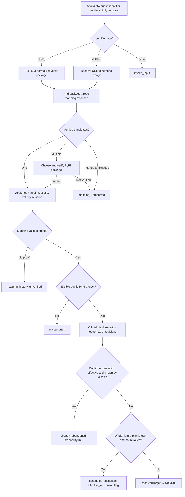

- A GitHub monorepo must resolve to a specific PyPI package; do not assume one repo equals one package.
- Only authoritative evidence available at cutoff sets status. Rumors and later discoveries cannot be backdated.

## D02 — Source Collection and Storage (T-012–T-020)

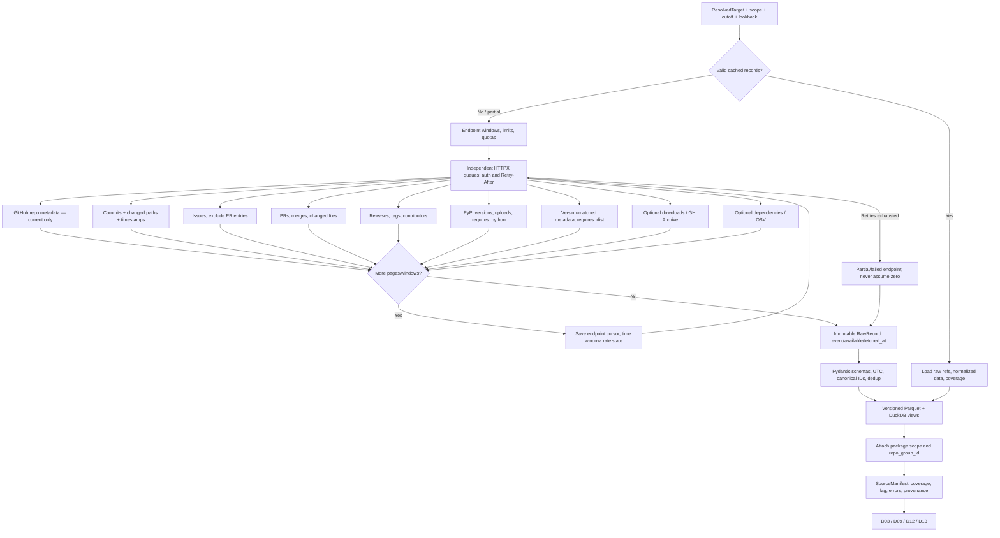

**Historical rule:** Current repository metadata, current issue state, totals, or dependency graph cannot be used as historical features without versioned as-of proof. Each endpoint checkpoints independently.

## D03 — Repository Functional Profiler

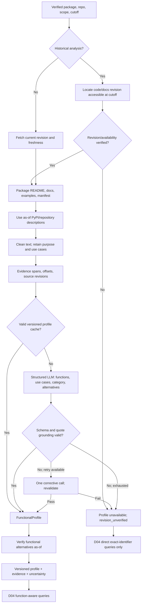

**Boundary:** A functional profile comes from the target package's versioned official documentation—not later documents, dependency guesses, or external articles.

## D04 — Query Planning and External Discovery (T-016)

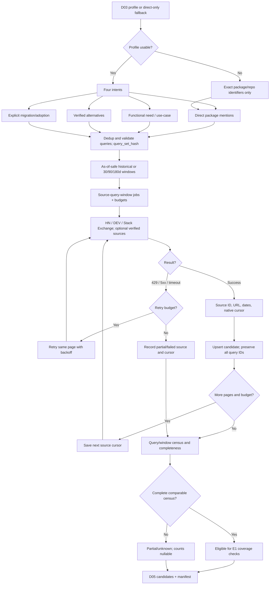

**Comparability:** Trend windows require the same *actual* query set, source, filters, and retrieval policy. Prefer shared source/window indexes; top-K results are not a complete census.

## D05 — External Documents and Relevance (T-017/T-018)

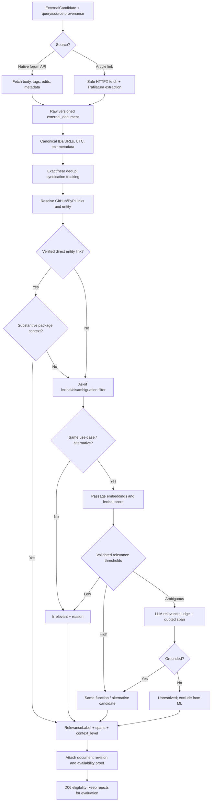

**E1 isolation:** Relevance may use an LLM, but E1 counts do not use D07 specialist-agent outputs.

## D06 — Temporal Evidence and Leakage Gates

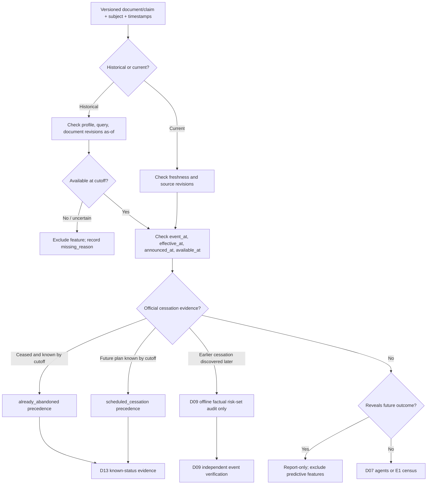

**Rule:** `published_at` alone does not validate an edited document's earlier contents. Known-outcome shortcuts are excluded from E1/E2 features, even if published before cutoff.

## D07 — Three Specialist Agents and Verification (T-024/T-025)

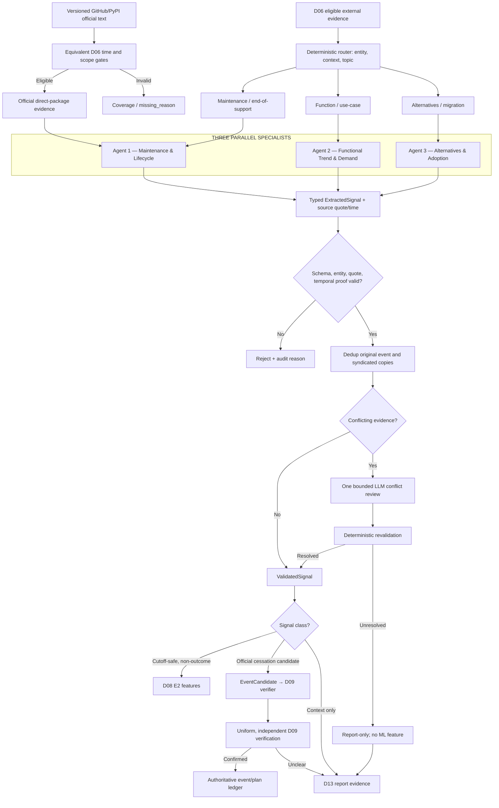

**Agent boundaries:** Agent 1 handles maintenance/lifecycle, Agent 2 functional demand (not package user counts), Agent 3 alternatives and explicit migrations. No additional LLM coordinator agent is required. Agents cannot modify labels or risk scores.

## D08 — E1/E2 Features and Coverage (T-022)

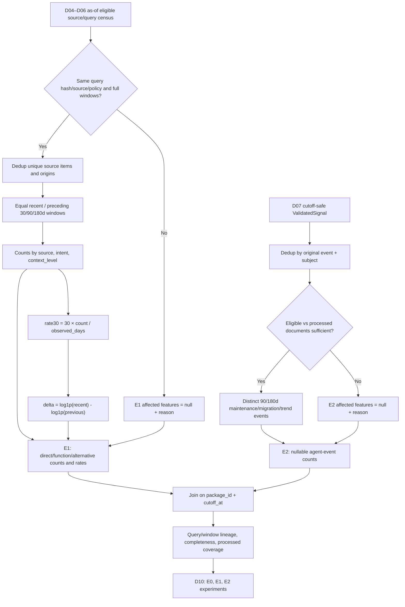

**Constraints:** Full windows are required for comparable rates; never extrapolate agent counts from top-K documents. E2 adds verified specialist-agent signals to E1 without double-counting events or introducing revealed outcomes.

## D09 — Historical Cohort, Core Features, and Labels

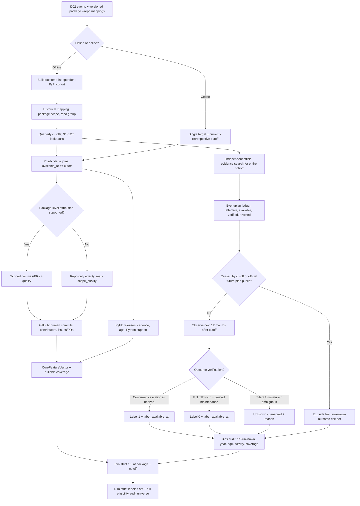

**Label policy:**
- `1`: Independently verified *effective cessation* within the 12-month horizon. An archive, inactivity, or unverified replacement alone is insufficient.
- `0`: Complete 12-month observation, consistent authoritative verification, and predefined evidence of ongoing maintenance/support. Absence of a cessation notice alone is insufficient.
- `unknown/censored`: Incomplete follow-up, silent project, uncertain mapping, contradictory evidence, or coverage gaps; excluded from supervised fitting.
- Discovery and verification must apply uniformly to the entire cohort; Agent 1 event candidates are only leads. Keep `label_available_at` separate from `effective_at`.

**Calibration scope:** Audit selection bias between the strict labeled cohort and the full eligible cohort. Do not claim ecosystem-wide calibrated risk without evidence.

## D10 — Leakage-Safe E0/E1/E2 Evaluation (T-023)

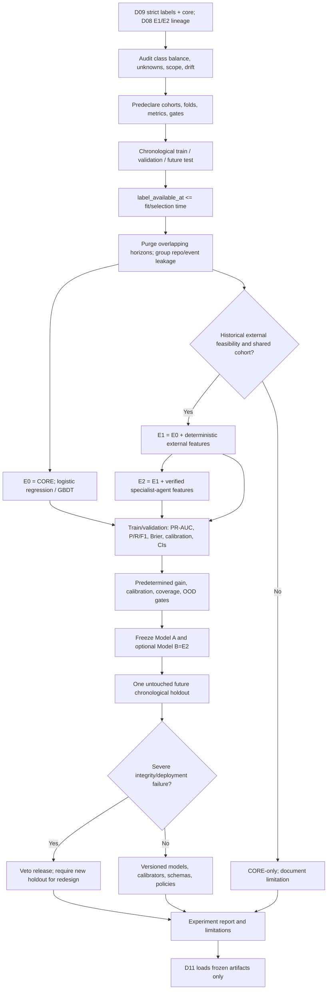

**Temporal contract:** Each row stores `cutoff_at`, `outcome_end_at`, `label_available_at`, `repo_group_id`, and optional `event_id`. Each fold records `fold_fit_at`, `selection_freeze_at`, `test_start_at`, and `evaluation_as_of`.

- Fit and tune only with labels available at their respective decision times. Never randomly split snapshot rows.
- Compare E0/E1/E2 on the **same E2-eligible cohort**; also evaluate E0 on the broader core-eligible cohort.
- Keep primary chronological generalization and secondary unseen-repository generalization separate.
- Final test **confirms or vetoes** frozen decisions; it does not select models, thresholds, or calibration.
- Model B requires validation-proven improvement, acceptable calibration, sufficient coverage, and compatible deployment artifacts.

## D11 — Online Inference and Fallback (T-027)

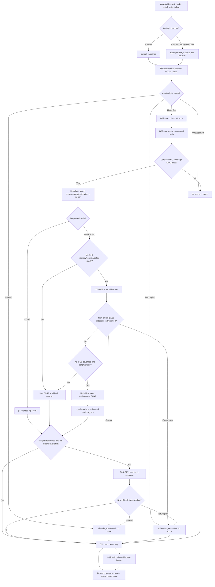

**Precedence and fallback:** Official known status clears any previously computed probability. If Model B or external coverage fails, return valid CORE with `mode_used=CORE` and a reason. CORE never calls external LLMs by default; report-only insights never generate `p_enhanced`. If applicability fails, return an explicit no-score.

## D12 — Reverse Dependency Impact (Optional)

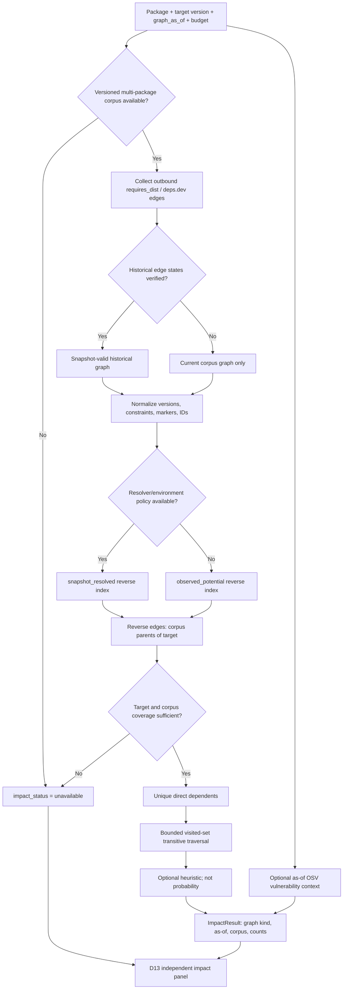

**Meaning:** Reverse dependencies require a *corpus of outbound edges from many packages*. Without it, impact is unavailable—not zero. `observed_potential` is not a global PyPI count; `snapshot_resolved` requires explicit version/environment resolution. Impact and OSV data do not alter abandonment risk.

## D13 — Final Report and Frontend (T-021/T-026/T-028/T-029)

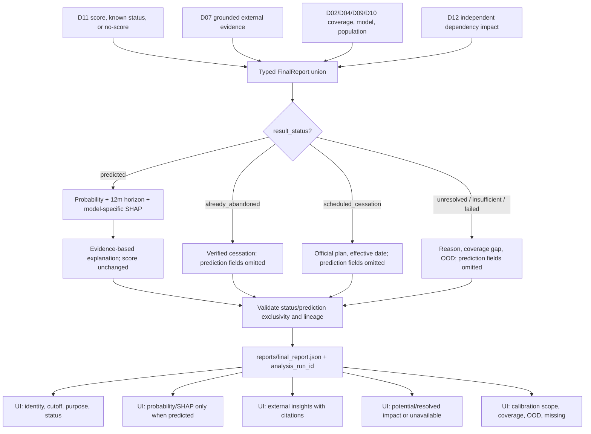

| Field | Requirement |
|---|---|
| Identity | `package_id`, `repo_id`, `cutoff_at`, `analysis_run_id`, mapping provenance |
| Purpose | `current_inference` / `retrospective_analysis` / D10-only `prospective_backtest` |
| Status | `predicted`, `already_abandoned`, `scheduled_cessation`, or explicit unresolved/insufficient/failed reason |
| Execution | `mode_requested`, `mode_used`, `enhanced_status`, `fallback_reason`, `external_insights_status` |
| Prediction | Only for `predicted`: calibrated `probability`, 12-month horizon, risk level, model/schema/calibration versions |
| Explanation | Model-specific SHAP; source-backed evidence and external context |
| Applicability | Training/calibration population, OOD/coverage assessment, uncertainty |
| Impact | Observed corpus counts and graph semantics, or `unavailable` |
| Lineage | Source revisions, availability times, query hashes, missing reasons, policy/model versions |

**Invariant:** Only `result_status="predicted"` includes `prediction` and `prediction.probability`. Known-status/no-score branches omit `prediction`, `core_prediction`, and `probability` entirely, including null-valued fields. A retrospective score must not be presented as prospective historical accuracy.

## D14 — Orchestration, Caching, and Failures

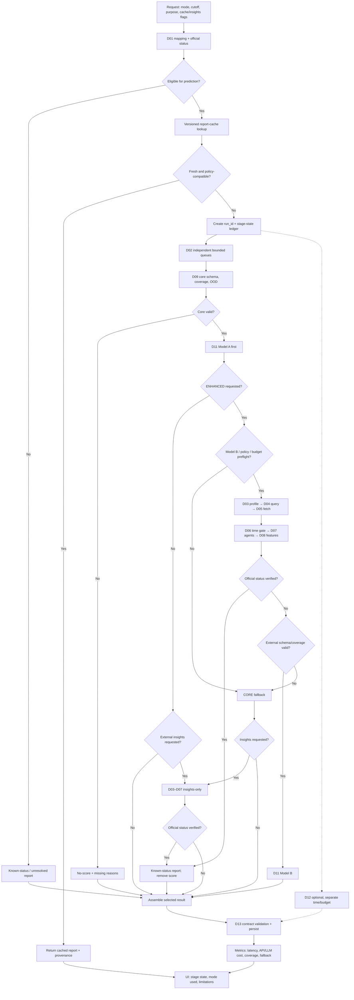

**Cache key:** Target/cutoff/purpose, mapping+scope revision, sources/freshness, profile/query/feature/label policies, model+calibration versions, official plan status, and insights flag. All stages use bounded budgets and explicit partial/error states; D12 failures never block a valid prediction.

## D15 — Artifacts and Data Lineage

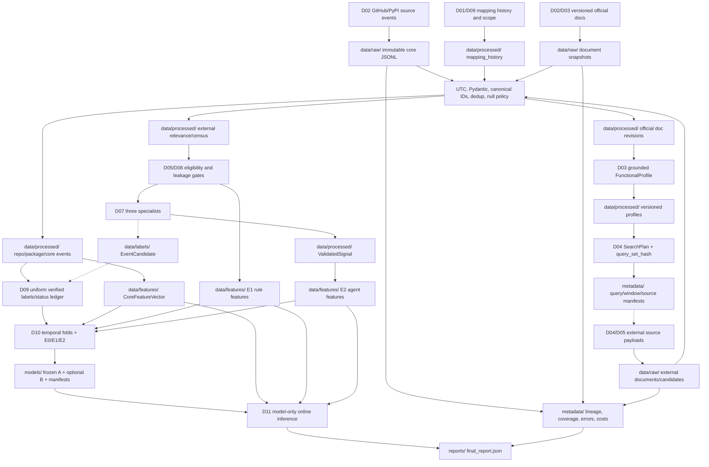

**Artifact rules:** Keep immutable raw evidence and versioned processed/features/models. Join at `package_id + cutoff_at`; preserve mapping, source, query, label, model, purpose and calibration lineage. E1 must not depend on agent output; D09 labels must not depend on which items agents happen to find.

---

## Appendix A — Core Data Contracts

| Contract | Key fields / invariant |
|---|---|
| `ResolvedTarget` | `package_id`, `repo_id`, `repo_group_id`, scope, mapping revision/validity, `cutoff_at`; verified package mapping |
| `RawRecord` / `SourceManifest` | Source and revision, `event_at`, `available_at`, `fetched_at`, `run_id`, coverage/error status; missing ≠ zero |
| `FunctionalProfile` | Package/cutoff, versioned official docs, evidence spans, mapping and profiler revisions |
| `ExternalCandidate` / `DocumentCensus` | Query hash/version, source/window/policy, source IDs, revision, counts and completeness |
| `ValidatedSignal` | Subject, context, type, timestamps, cited offsets, source and agent versions; not a ground-truth label |
| `CoreFeatureVector` | Package/cutoff, as-of values, scope quality, mapping/feature revisions and coverage |
| `ExternalRuleFeatureVector` (E1) | Query/source comparability, nullable counts/rates; no specialist-agent outputs |
| `ExternalAgentFeatureVector` (E2) | Nullable event counts, processed/eligible document counts, event dedup and signal version |
| `VerifiedCessationEvent` / `OfficialPlan` | Official authority, event/effective/announced/available times, revision, source ref, revocation state |
| `HistoricalLabel` | Package/cutoff/horizon, `1/0/unknown`, `label_available_at`, policy, event/reason |
| `ModelManifest` | Fit time, schema/order, preprocess/calibration, label/source/query policies, population/OOD limits, test manifest |
| `AnalyzeRequest` / `FinalReport` | Cutoff, purpose, requested/used mode, status, evidence/coverage/lineage, optional prediction and impact |

**As-of status changes:** `status_unverified → scheduled_cessation` (verified future plan); `scheduled_cessation → status_unverified` (plan withdrawn); `scheduled_cessation → already_abandoned` (effective cessation verified); or `status_unverified → already_abandoned` (direct confirmation). Changes after cutoff do not rewrite historical known status.

## Appendix B — Release Gates

**Model A / CORE:** Valid operational labels and uniform discovery; historically valid core features/mapping; time-safe folds and label availability; missingness, selection-bias and OOD audits; validation-calibrated thresholds and abstention; untouched final test.

**Model B / ENHANCED:** Versioned historical text; comparable source-query-window census; documented agent-processing coverage; matched E0/E1/E2 cohorts; validated incremental gain and calibration; compatible registry/online schemas and reliable CORE fallback. Otherwise ship **CORE + optional external insights**.

**UI:** Distinct known status, prediction and no-score paths; accurate inference purpose; grounded source/time citations; separate insights and impact; visible fallback, coverage, calibration population and OOD limitations.

**Freeze before testing:** Cohorts/folds, label rules, relevance/census policy, sampling budget, coverage/OOD gates, calibration, thresholds and acceptance criteria must be fixed using train/validation, **not** the final holdout.

## Appendix C — Implementation Phases

1. **Foundation:** D01, D02, D09, D10/E0, D11 CORE, minimal D13–D15.
2. **External feasibility / E1:** D03–D06, D08/E1, D10/E1; document limitations if historical data are unavailable.
3. **Agents / E2 / UX:** D07, D08/E2, D10/E2, D11 ENHANCED/fallback, optional D12, full D13–D15.

**Unverified until implemented:** Positive/negative label volume, historical source availability, census completeness, E1/E2 lift, deployment-population calibration, and reverse-dependency coverage. Keep D00–D15 and **exactly three specialist agents**; deploy enhanced scoring only when its gates are met.
